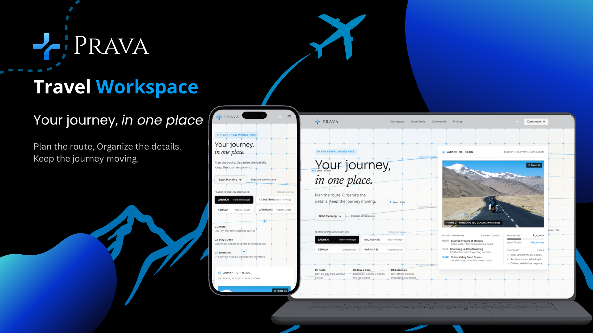
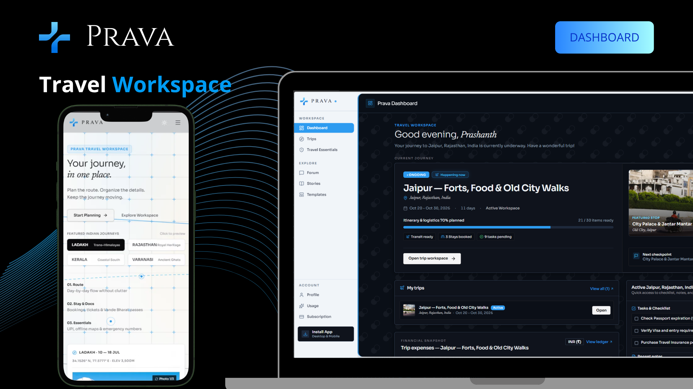
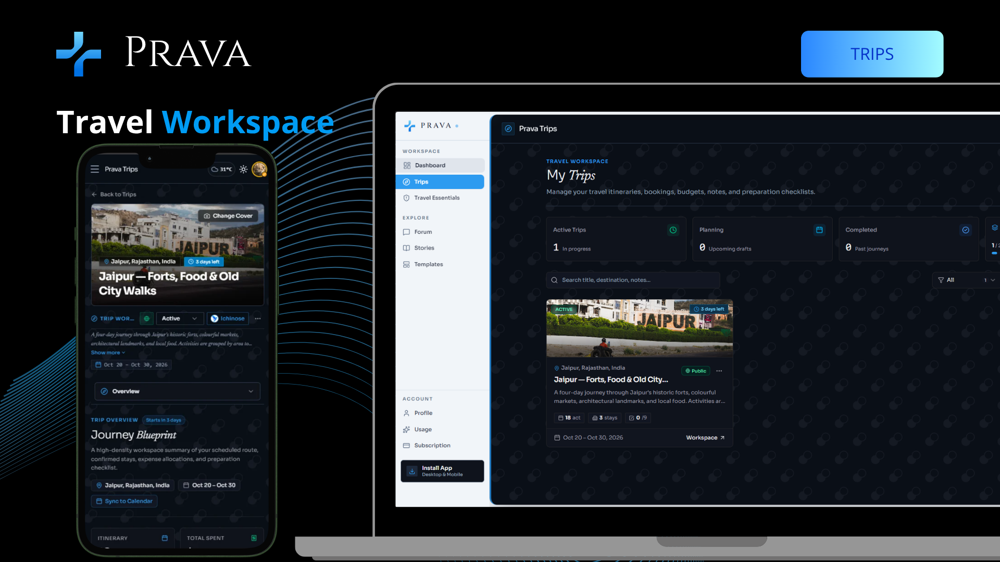
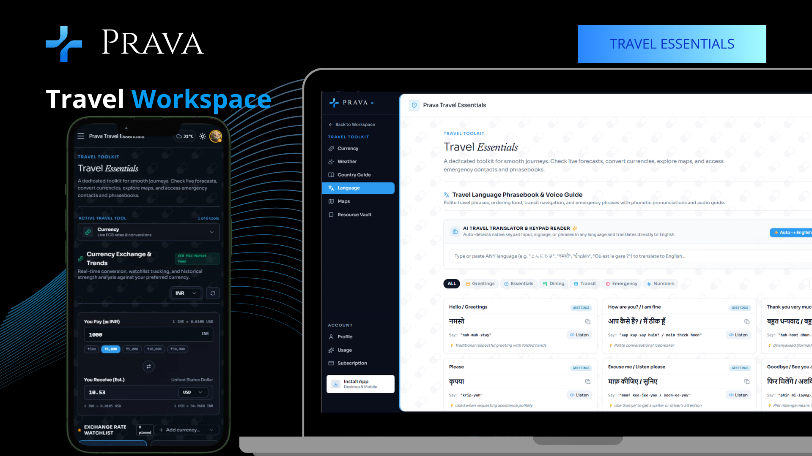
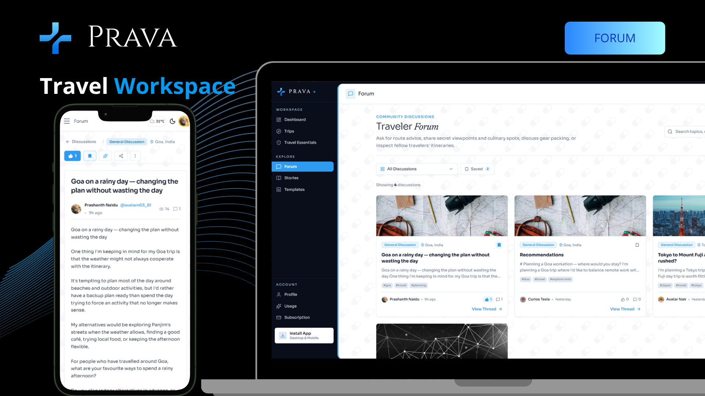
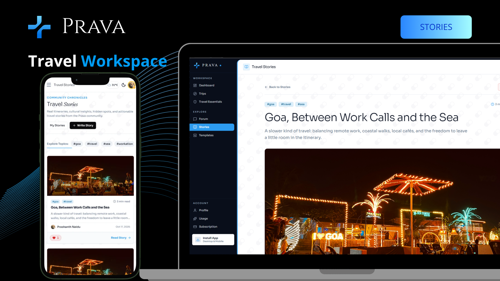
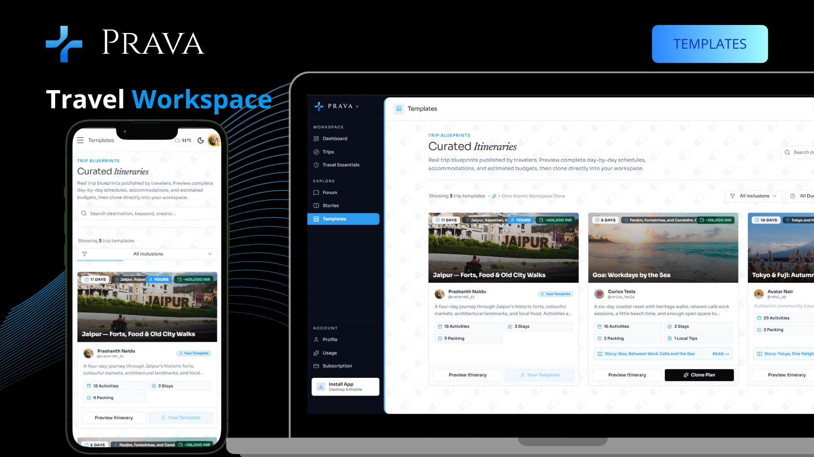
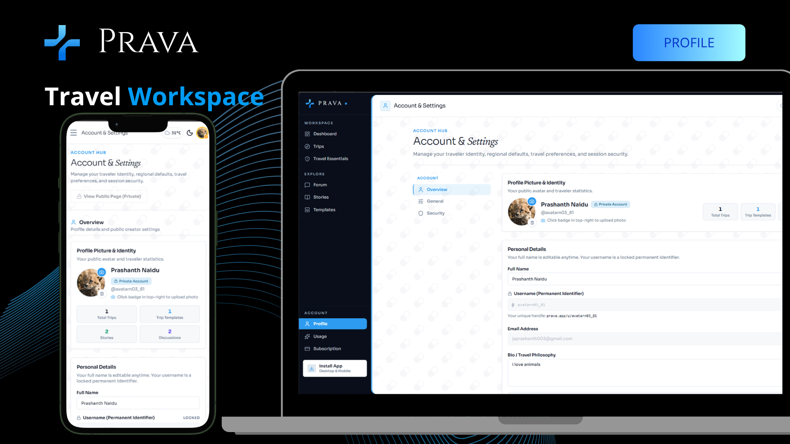

<div align="center">


# Prava Travel Workspace
### Workspace-First Travel Operating System

**A persistent, structured productivity workspace for modern travelers — combining Linear & Notion-grade trip organization with contextual Gemini & multi-model intelligence, live travel essentials, and an open community.**

[](https://nextjs.org/)
[](https://react.dev/)
[](https://tailwindcss.com/)
[](https://www.prisma.io/)
[](https://supabase.com/)
[](#)
[](https://polar.sh/)
[](https://www.typescriptlang.org/)
[](LICENSE)

<br />
<br />



</div>

---

## 📑 Table of Contents

- [💡 What is Prava?](#-what-is-prava)
- [🎯 Why Prava? (The Problem & Core Philosophy)](#-why-prava-the-problem--core-philosophy)
- [⚡ How It Works](#-how-it-works)
- [📸 Visual Tour & Page Previews](#-visual-tour--page-previews)
- [🗺️ Key Features & Modules](#️-key-features--modules)
  - [1. Cross-Trip Dashboard](#1-cross-trip-dashboard)
  - [2. Trip Workspace (7 Sub-Modules)](#2-trip-workspace-7-sub-modules)
  - [3. Ichinose AI Assistant & Proposal Engine](#3-ichinose-ai-assistant--proposal-engine)
  - [4. Live Travel Essentials (Obsidian Suite)](#4-live-travel-essentials-obsidian-suite)
  - [5. Community Hub, Stories & Creator Profiles](#5-community-hub-stories--creator-profiles)
  - [6. Subscription Billing & Quota Governance](#6-subscription-billing--quota-governance)
  - [7. Offline Sync & Media Optimization](#7-offline-sync--media-optimization)
- [🏗️ Technical Architecture & Stack](#️-technical-architecture--stack)
- [📚 Project Documentation](#-project-documentation)
- [📁 Codebase Organization](#-codebase-organization)
- [🎨 Design & Product Philosophy](#-design--product-philosophy)
- [📄 License & Copyright](#-license--copyright)

---

## 💡 What is Prava?

**Prava Travel Workspace** is an all-in-one travel operating system designed for travelers, digital nomads, and explorers who want a focused, reliable workspace rather than scattered apps.

Instead of juggling spreadsheets for budgets, chat apps for links, notes apps for packing, and separate tabs for weather and exchange rates, Prava unites the entire journey lifecycle into a single system of record:

1. **Pre-Trip Planning**: Build itineraries, track accommodations, set spending targets, and organize packing lists.
2. **On-the-Ground Execution**: Access real-time 5-day weather forecasts, live European Central Bank currency conversions, interactive maps, offline cached itineraries, and emergency dispatch numbers for 250+ countries.
3. **Post-Trip Reflection & Sharing**: Archive completed journeys, write long-form travel stories in Markdown, and publish curated itinerary templates for the community to clone in one click.

---

## 🎯 Why Prava? (The Problem & Core Philosophy)

### The Frustration
Travel planning today is broken and fragmented:
- **Scattered Information**: Booking confirmations get lost in email inboxes; itineraries sit in static Google Docs; budgets are trapped in clunky spreadsheets.
- **The "AI Slop" Trap**: General-purpose chatbots generate vague bullet points in temporary chat bubbles. They cannot persist state, reconcile multi-currency expenses, or update real database records safely.
- **Inflexible Creation**: Many travel apps force users through rigid 15-step wizards or mandate AI generation for every simple task.

### Prava's Core Tenets

#### 1. Workspace First, AI Second
The heart of Prava is structured, durable, user-owned data. Every core workflow—adding an itinerary event, logging an expense, recording a hotel confirmation, or checking off packing items—can be performed **100% manually with zero AI dependency**. AI is an accelerant, never a gatekeeper.

#### 2. "The Application Remembers, The LLM Does Not"
Large Language Models are inherently stateless. Prava treats the database (PostgreSQL via Prisma) as the single source of truth. When the AI assists you, Prava dynamically assembles live workspace context, instructs the model, and parses any planned changes into reviewable database proposals.

#### 3. Transactional AI Proposals (No Hallucinated Edits)
The AI assistant (**Ichinose**) does not silently mutate your database. It generates structured JSON proposals that render in visual **Proposal Cards** with field diffs and checkboxes. You choose to **Accept All**, **Apply Selected**, or **Reject**, executing an atomic Prisma `$transaction` only upon your confirmation.

#### 4. Productivity-Grade Craftsmanship
Prava explicitly rejects chat-first gimmicks, neon gradients, and floating decorative clutter. Modeled after high-efficiency software like **Linear, Notion, GitHub, and Stripe Dashboard**, Prava prioritizes data density, calm typography, crisp card borders, and clear interactive affordances.

---

## ⚡ How It Works

```text
┌─────────────────────────────────────────────────────────────────────────────┐
│                             PRAVA TRAVEL WORKSPACE                          │
│                      "Workspace First, AI Second" Engine                    │
└──────────────────────────────────────┬──────────────────────────────────────┘
                                       │
                         [ 1. Create or Clone Trip ]
                     (Unsplash Cover • Dates • Budget)
                                       │
                                       ▼
┌─────────────────────────────────────────────────────────────────────────────┐
│                         CORE 7-MODULE TRIP WORKSPACE                        │
│   Overview  •  Itinerary  •  Stays  •  Expenses  •  Notes  •  Tasks  •  Vault   │
└──────────────────────┬───────────────────────────────┬──────────────────────┘
                       │                               │
        [ Manual Planning (Zero-AI) ]      [ Ichinose AI Assistant ]
         • Full CRUD on all records         • Multi-Model Routing
         • Calendar Sync (Google / .ics)    • Gemini 3.x Flash (Primary Planning)
         • Localized Currency & Budget      • Gemini Flash Lite (Conversations)
         • Interactive SVG Charts           • Free Open-Model Resilience
                       │                               │
                       │                               ▼
                       │                   [ Visual Proposal Card ]
                       │                   • Inspect item diffs & checkboxes
                       │                   • Accept All / Partial / Reject
                       │                               │
                       │             Commit Action     ▼
                       └───────────────────◄─── [ Atomic $transaction ]
                                                       │
                                                       ▼
┌─────────────────────────────────────────────────────────────────────────────┐
│                            EXECUTION & COMMUNITY                            │
│   Live Essentials (Weather, FX, Maps) • Community Feed • 1-Click Trip Clones │
└─────────────────────────────────────────────────────────────────────────────┘
```

1. **Start a Journey**: Create a new trip with destination autocompletion, Unsplash tour-vibe photography, scheduled dates, and target budget goals. Or clone a community template in 1 click.
2. **Organize in the 7 Workspace Tabs**: Manage your itinerary, lodging, categorized expenses, notes, checklists, and reference links in dedicated tabs.
3. **Collaborate with Ichinose**: Open the docked 3-column AI assistant to brainstorm activities, ask destination questions, or generate multi-day drafts. Review structured diffs and apply them atomically.
4. **Sync & Travel**: Export schedules to Google Calendar or RFC 5545 `.ics` files, consult live currency rates and weather forecasts, and access cached data even with spotty connectivity.

---

## 📸 Visual Tour & Page Previews

> *High-fidelity interface walkthrough of Prava across desktop and mobile devices.*

### 1. Landing Page & Journey Explorer
*Multi-device responsive discovery portal with interactive route mapping, featured journeys (Ladakh, Rajasthan, Kerala, Varanasi), and instant workspace onboarding.*


---

### 2. Cross-Trip Command Dashboard
*Centralized travel headquarters tracking active journey countdowns ("Jaipur — Forts, Food & Old City Walks"), 70% logistics completion indicators, transit status, upcoming checkpoints, high-priority checklists, and cross-trip financial snapshots.*



---

### 3. Trips Management & Journey Blueprints
*All-in-one trip manager categorized by status (Active, Planning, Completed) with Unsplash tour-vibe photography, scheduled dates, and instant transition to the 7-submodule trip workspace.*



---

### 4. Live Travel Essentials (Obsidian Suite)
*Real-time currency converter with live European Central Bank exchange rates and trend tracking alongside an interactive AI Travel Language Phrasebook & Voice Guide with phonetic pronunciations and audio reader.*



---

### 5. Community Forum & Discussion Hub
*Open traveler community with categorized discussions (Goa, Japan, packing tips, route planning), upvoting, thread view counts, and 1-click "Save Tip to Trip Note" integration.*



---

### 6. Travel Stories & Creator Chronicles
*Long-form Markdown travel publication platform with rich hero photography, author profiles, reading time estimates, and linked 1-click trip cloning ("Goa, Between Work Calls and the Sea").*



---

### 7. Curated Templates & 1-Click Trip Clones
*Handcrafted trip blueprints published by verified travelers (Jaipur, Goa, Tokyo & Fuji). Includes complete day-by-day schedules, accommodations, and 1-click atomic cloning into your private workspace.*



---

### 8. Account & Creator Profile Hub
*Traveler profile and identity hub with custom avatar uploads, traveler statistics counter (Total Trips, Templates, Stories, Discussions), regional defaults, and public portfolio settings.*



---

## 🗺️ Key Features & Modules

### 1. Cross-Trip Dashboard
Located at `/dashboard`, the Dashboard aggregates all active and historical travel data:
- **Journey Status Intelligence**: Displays upcoming countdown badges (`"Happening now"`, `"Tomorrow"`, `"N days left"`) with animated status indicators. Concluded journeys automatically transition to `"Previous Journey"` with a `"Ready for your next adventure?"` quick-create action.
- **Trip Statistics**: High-level cross-trip metrics (Total Trips, Active Itineraries, Logged Expenses, Pending Tasks).
- **Recent Trips Grid**: Quick access cards with destination tags, dates, and direct links to workspace subtabs.
- **Urgent Checklist Widget**: Surfaces uncompleted items across upcoming trips with immediate checkbox toggling.

---

### 2. Trip Workspace (7 Sub-Modules)
Each trip operates in its own dedicated, accessible workspace (`/trips/[tripId]`) powered by persistent header controls and router-synchronized tabs:

| Sub-Module | Key Capabilities |
|---|---|
| **Overview** | KPI cards (countdown, budget spent vs goal headroom, packing progress, stop count), Unsplash cover picker with 6-image preview, scheduled dates advisory banner, and **Google Calendar / RFC 5545 `.ics` Export**. |
| **Itinerary** | Chronological daily timeline with day switcher, start times, category tags (Activity, Food, Transit), locations, and costs. Includes **Empty-State AI Kickstart** to generate a full starter plan in 1 click or plan manually. |
| **Accommodations** | Lodging cards (Hotels, Hostels, Airbnbs, Resorts) with check-in/out dates, addresses, confirmation codes, provider contact info, and nightly cost breakdowns. |
| **Expenses** | Full financial ledger with persistent database budget goal (`trip.budget`), 24+ global currency symbol support, sticky header receipts table, category filter dropdown, CSV export, and **Interactive SVG Donut Chart** with synchronized hover breakdown. |
| **Notes** | Long-form Markdown travel notes with note pinning, category filtering, search, and auto-save. |
| **Checklist** | Pre-departure & packing tasks with category filters, progress indicators, 1-click **Starter Essentials (Free)** seeding with deduplication, and **Smart AI Packing List (-3 credits)** generator. |
| **Links** | Trip bookmark repository with domain favicon badges, categorization, notes, and a 1-click **"Import from Global Vault"** bridge. |

---

### 3. Ichinose AI Assistant: Gemini Primary + Multi-Model Routing
Integrated directly as a persistent right-side flex companion (`AppShell` level), **Ichinose** provides deep travel context awareness:

- **Intelligent Multi-Model Routing Strategy**:
  - **Primary Reasoning Engine — Google Gemini (3.x & 2.5 Flash)**: Acts as the core workhorse for complex multi-day itinerary kickstarts, structured proposal generation, context assembly across all 7 workspace modules, and transactional database planning.
  - **Conversational Engine — Gemini 3.1 Flash Lite**: Powers rapid, low-latency responses for general travel Q&A, destination advice, language tips, and conversational guidance.
  - **Resilience & Free Fallback Engine — OpenRouter Free**: Automatic fallback to high-throughput open models (`nvidia/nemotron-3.5-lightning:free` and `openrouter/free`) during API rate-limiting or when monthly credits are depleted, ensuring travelers are never locked out of advice.
- **3-Column Companion Architecture**: Sits alongside the Sidebar (`w-52`) and Center Canvas (`flex-1`) with symmetrical opposite-theme mirroring (dark obsidian `#090E1A` in light mode, clean slate in dark mode).
- **Custom Japanese-Minimalist Persona**: Branded with a circular portrait avatar wearing a glowing cerulean headset, dedicated 3-dot session actions menu (Rename Chat, Delete Chat), and a bottom AI verification disclaimer.
- **Deterministic 4-Tier Complexity Evaluator**:
  - **Tier 1 (1 Credit)**: Quick tool queries & fact Q&A (< 12 words, weather lookups, currency conversion, emergency numbers).
  - **Tier 2 (2 Credits)**: Contextual destination advice, neighborhood tips, and scoped recommendations.
  - **Tier 3 (3 Credits)**: Specialized generation (tailored packing checklists, comprehensive notes, single-day schedules).
  - **Tier 4 (5 Credits)**: Heavy multi-day itinerary generation (>= 3 days, full day-by-day schedules).
- **Transactional Proposal Engine (`AiProposal`)**:
  - Gemini emits strictly typed JSON payloads conforming to `aiProposalPayloadSchema`.
  - Displayed in modern, rounded `AiProposalCard` with action badges (`Add`, `Update`, `Remove`), metadata chips (day, time, location, cost), and selection checkboxes.
  - Travelers can review changes, selectively check items, and click **Accept All**, **Apply Selected**, or **Reject**.
  - On acceptance, an atomic Prisma `$transaction` commits validated records into PostgreSQL.
- **Conversation Thread Management**:
  - Supports up to 15 messages per thread (`MAX_MESSAGES_LIMIT = 15`) to prevent context bloating and token runaway.
  - Dedicated History switcher tab to review, rename, or delete previous threads.

---

### 4. Live Travel Essentials (Obsidian Suite)
Located at `/travel-essentials`, built with a spacious **Max-Width 7XL** layout featuring a deep obsidian dark aesthetic (`#0C1322`, `#080D18`) paired with Prava Cerulean Blue accents (`#2D9BF0`):

1. **Weather Radar & Forecast**: Powered by OpenWeather API with 5-day / 3-hour granular timelines, atmospheric matrix (humidity, wind speed, pressure, UV index), and city quick-select pills.
2. **Currency Exchange & Trend Analytics**: Live European Central Bank exchange rates via the Frankfurter API, 24+ global currencies, interactive SVG historical trend charts (7D, 1M, 3M, 1Y), and personal watchlists.
3. **Country Guide**: Comprehensive profiles for 250+ nations via REST Countries v3.1 (Emergency dispatch info, capital, timezone, languages, currencies, cultural etiquette dos & don'ts).
4. **Interactive Leaflet Maps**: OpenStreetMap integration with Nominatim search, GPS geolocation finder, custom map pins, and nearby points of interest.
5. **Worldwide Emergency Hub**: Verified emergency dispatch numbers (Police, Ambulance, Fire) for international travelers.
6. **Language Phrasebook**: Interactive audio reader with Web Speech API pronunciation playback, bidirectional translation, and category filters (Essentials, Dining, Transit, Emergency).
7. **Travel Resource Vault**: Centralized travel bookmark repository with a 1-click **"Attach to Trip"** bridge.

---

### 5. Community Hub, Stories & Creator Profiles
- **Curated Templates (`/templates`)**: Handcrafted itineraries for world-class destinations (Kyoto, Amalfi Coast, Swiss Alps, Paris, Bali) with **1-Click Workspace Cloning** that duplicates the entire trip structure into your private account.
- **Travel Stories (`/stories`)**: Long-form Markdown travel blog posts with custom cover photos, reading time estimates, author attribution, and linked trip clones.
- **Discussion Forum (`/forum`)**: Community threads categorized by destination and topic (Packing Tips, Route Advice, Hidden Gems) with nested replies, upvoting, and a **"Save Tip to Trip Note"** action.
- **Public Creator Profiles (`/u/[username]`)**: Public portfolio showcasing verified creators, bios, published itineraries, and travel stories under an immutable `@username` handle. Accounts feature a "View as Public Visitor" preview button.

---

### 6. Subscription Billing & Quota Governance
Located at `/subscription` and `/usage`:
- **Polar Payments Integration**: Powered by Polar (Merchant of Record) with monthly and annual billing cycles, customer portal sessions for payment method updates, and secure webhook validation (`/api/webhooks/polar/route.ts`).
- **Dynamic Localized Currency Conversion**: Converts USD subscription pricing ($12/mo, $99/yr) into your preferred local currency (INR `₹`, EUR `€`, GBP `£`, CAD, AUD, JPY, etc.) with live rates and annual savings calculations.
- **Tier Quota Structure**:
  - **Free Explorer**: Up to 10 trips, 30 AI planning credits per month.
  - **Pro Wanderer**: Up to 25 trips, 150 AI planning credits per month.
- **Usage & Analytics**: Real-time quota consumption meters, 6-month historical billing cycles chart, and trip-by-trip credit consumption breakdowns.

---

### 7. Offline Sync & Media Optimization
- **Offline Cache via IndexedDB**: Uses `idb` to cache trip workspaces locally in the browser. Changes queue client-side and automatically synchronize when internet connectivity resumes.
- **Canvas Image Optimization**: User avatars are downscaled client-side to 512x512 WebP/JPEG using an HTML5 Canvas pipeline before upload, minimizing bandwidth and Supabase storage footprint.
- **Reference-Counted Cover Image Management**: Automatically tracks image usage across duplicated and cloned trips to ensure shared media assets are never prematurely deleted.

---

## 🏗️ Technical Architecture & Stack

| Layer | Technology | Version / Details |
|---|---|---|
| **Framework** | Next.js (App Router) | **16.3.3** (Turbopack, Server Components & Server Actions, `proxy.ts`) |
| **Runtime & UI** | React | **19.2.8** (Concurrent rendering, Suspense, Server Actions) |
| **Styling** | Tailwind CSS | **v4.x** (CSS-first `@tailwindcss/postcss`, theme variables in `app/globals.css`) |
| **Component Primitives** | shadcn/ui & Radix UI | Dialog, Select, Tabs, Popover, Calendar, Switch, Accordion, Tooltip, Avatar |
| **Database & ORM** | PostgreSQL + Prisma ORM | **Prisma 7.10.0** (`@prisma/adapter-pg`, connection pooling via PgBouncer) |
| **Authentication** | Supabase Auth SSR | `@supabase/ssr`, server-side PKCE code exchange in `/auth/callback` |
| **Storage** | Supabase Storage | `prava-media` bucket with user-scoped folders & Canvas downscaling |
| **Primary AI Engine** | Google Gemini | `@google/genai` (`gemini-3.8-flash`, `gemini-3.7-flash`, `gemini-3.6-flash`, `gemini-3.1-flash-lite`) |
| **Multi-Model Fallback** | OpenRouter Free | Open-weight resilience models (`nvidia/nemotron-3.5-lightning:free` and `openrouter/free`) |
| **Payments** | Polar Payments | `@polar-sh/sdk` recurring subscriptions, customer portal, webhooks |
| **Offline Engine** | IndexedDB (`idb`) | Client-side persistent cache and background synchronization |
| **External APIs** | Unsplash, OpenWeather, Frankfurter, REST Countries, Leaflet/OSM | Real-time live integrations with graceful error boundaries |

---

## 📚 Project Documentation

For deep technical insights, design rationale, and system architecture specifications authored throughout the engineering of Prava, explore the architectural documentation:

- [Product Vision & Philosophy](docs/01-product-vision.md) — The founding thesis, problem space, user personas, and the *"Workspace First, AI Second"* doctrine.
- [Design System & Typography](docs/02-design-system.md) — The 3-tier font system (Cinzel, Sora, Newsreader), dual-theme tokens, component standards, and the obsidian aesthetic.
- [System Architecture](docs/03-system-architecture.md) — Monolithic server-first architecture, database schemas, AI context assembler, and transactional proposal engine.
- [Engineering Roadmap](docs/implementation-roadmap.md) — The multi-phase engineering progression, architectural decisions, and module delivery milestones.
- [Polar Subscription Architecture](docs/polar-subscription.md) — Merchant of Record integration, webhook idempotency, cryptographic signatures, and customer portal sessions.

---

## 📁 Codebase Organization

Prava enforces a **feature-first** modular architecture designed for high maintainability and clear domain boundaries:

```
prava/
├── app/                              # Next.js App Router (pages, layouts, route handlers)
│   ├── (workspace)/                  # Protected workspace layout group (Persistent AppShell)
│   │   ├── dashboard/                # Cross-trip overview & metrics
│   │   ├── trips/                    # Trips list & [tripId] 7-tab workspace
│   │   ├── travel-essentials/        # Weather, FX, Maps, Guides, Emergency, Language, Vault
│   │   ├── templates/                # Curated itineraries & 1-click cloner
│   │   ├── forum/                    # Community discussion forum & thread viewer
│   │   ├── stories/                  # Travel stories & markdown creator
│   │   ├── profile/                  # Account & Settings hub (Overview, General, Security)
│   │   ├── subscription/             # Polar billing & Customer Portal
│   │   ├── usage/                    # AI & Storage Quota meters
│   │   └── u/[username]/             # Public creator showcase
│   ├── auth/                         # Sign In, Sign Up, Forgot Password & PKCE callback
│   ├── api/webhooks/polar/           # Polar billing webhook handler
│   └── page.tsx                      # Dynamic landing page (dynamic auth detection)
├── components/                       # Shared UI primitives
│   ├── app-shell/                    # Fixed Sidebar, TopBar, ConfirmDeleteDialog
│   ├── storage/                      # AvatarUpload, CoverImage, ImageUpload
│   └── ui/                           # shadcn/ui primitives (button, card, dialog, select, etc.)
├── features/                         # Feature-first business domains
│   ├── blog/                         # Story editor, markdown renderer, publishing actions
│   ├── community/                    # Forum discussions, thread replies & upvoting
│   ├── dashboard/                    # Metric queries & summary components
│   ├── pricing/                      # Tier configurations, usage meters & Polar actions
│   ├── profile/                      # Username generator, general preferences, delete account
│   ├── storage/                      # Supabase storage server actions & garbage collection
│   ├── subscription/                 # Polar billing integration & customer portal
│   ├── templates/                    # Curated trip templates & 1-click clone engine
│   ├── travel-essentials/            # Weather, FX, Country, Maps, Emergency, Language, Vault
│   ├── trip-workspace/               # 7 workspace sub-modules + Ichinose AI proposal engine
│   └── trips/                        # Trips CRUD, Unsplash picker, shadcn DatePickers
├── lib/                              # Core singletons and infrastructure utilities
│   ├── ai/                           # Gemini client initialization & model cascade
│   ├── auth/                         # Safe profile sync helper (syncUserProfile)
│   ├── calendar/                     # Google Calendar URL & .ics export engine
│   ├── db.ts                         # Prisma client singleton with pg adapter
│   ├── offline/                      # IndexedDB offline store & synchronization
│   ├── storage/                      # Supabase Storage client
│   ├── supabase/                     # Supabase SSR client & proxy middleware
│   └── utils/                        # Canvas image resizer & string helpers
├── prisma/                           # schema.prisma & PostgreSQL migrations
└── services/                         # Cross-cutting server integrations (context-builder, unsplash)
```

---

## 🎨 Design & Product Philosophy

Prava follows strict productivity and interface principles inspired by high-efficiency software:

- **Calm & Minimal**: Generous whitespace, subtle borders, and crisp typographical hierarchy over decorative gimmicks.
- **No AI Slop**: Explicit rejection of chat-first chrome, floating bubbles, neumorphism, heavy decorative gradients, or glowing neon animations.
- **Brand Palette**:
  - Primary: Prava Cerulean Blue (`#2D9BF0`)
  - Accent: Sky / Ice (`#F0F8FF` / `#E0F2FE`)
  - Light Canvas: Slate background (`#F8FAFC`) with slate typography (`#1E293B`)
  - Dark Canvas: Deep obsidian navy (`#0C1322`, `#090E1A`)
- **Explicit Affordances**: All interactive surfaces, buttons, and links strictly render `cursor: pointer`.
- **Content-First Focus**: Data density and readability take absolute precedence over ornamentation.

---

## 📄 License & Copyright

**Prava Travel Workspace** is authored and maintained by **AvatarN03**.

- This project is licensed under the **[MIT License](LICENSE)**.
- **Copyright © 2026 AvatarN03**.
- You are free to inspect, learn from, fork, and contribute to this project under the terms of the MIT License.
